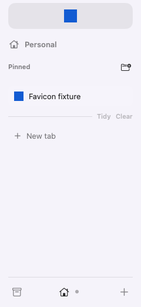

# Favicon restore evidence

Hidden two-process run of `scripts/test-shaar-favicon.py` against
`build/Shaar Verification.app` (shaar.28). The first process pinned the
loopback page, opened a second copy, and moved that copy to Favorites.
After quit and relaunch, the sidebar below was rendered offscreen. The
pin had no live icon yet, so the square came from the on-disk cache. The
Favorite stayed unloaded.

The blue squares are the fixture icon. Before the cache-key copy, the
Favorite showed a letter and the pinned row showed the pin symbol.

