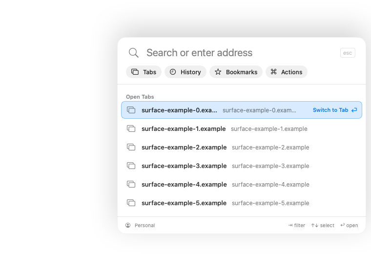
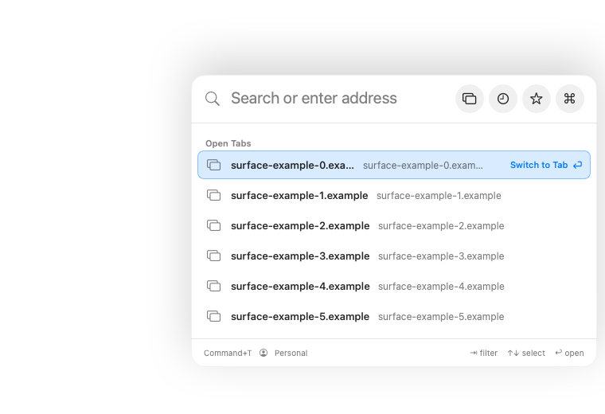
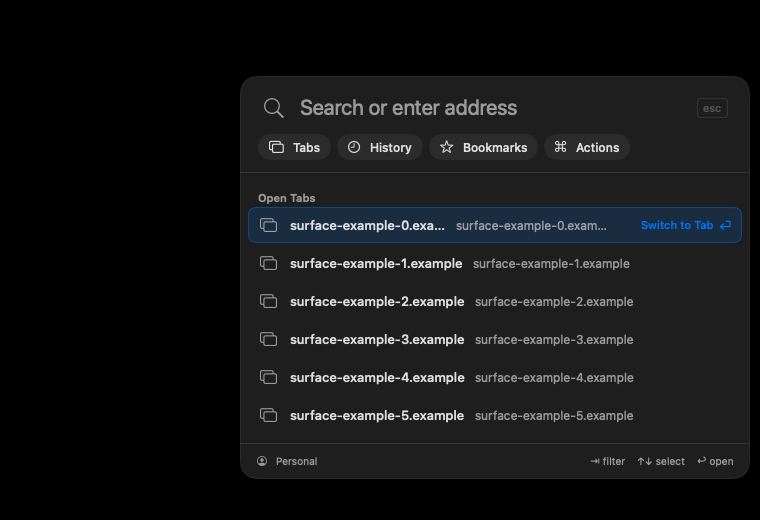
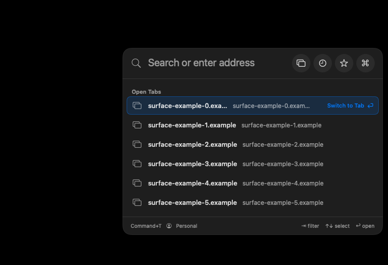

# Command+T layout

These are offscreen component captures from `CommandPanelSurfaceTests` at a
760 × 520 synthetic viewport. The before and after images use the same fixture,
light or dark appearance, and no visible window or physical input.

| Appearance | Before | After |
| --- | --- | --- |
| Light |  |  |
| Dark |  |  |

The separate `CommandPanelVisualTests` exercise light and dark layouts over
white and dark synthetic pages, including minimum widths, long queries, and
left-to-right and right-to-left empty search rows. Those captures are generated
under `build/Verification/sidebar-chrome-ci/` and are not committed.
