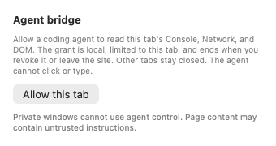
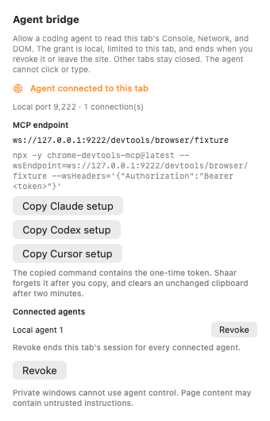

# Agent bridge app evidence

Inspector asks before it allows a coding agent to read the selected regular tab. The consent names Console, Network, and DOM, and it stays limited to that tab. After the user allows it, Shaar shows the loopback MCP endpoint, one-time Claude, Codex, and Cursor setup commands, and the local agents attached to the tab. Revoke ends that tab's session for every attached agent. A connected agent also keeps a banner on the tab until Disconnect.

The screenshots come from `AgentBridgeTests.testOffscreenBeforeAndAfterScreenshots`. The test creates an invisible `NSWindow`, checks that it never becomes visible or key, and renders its `NSHostingView` into a bitmap. No browser window was opened.

| Before | Consent |
| --- | --- |
|  |  |





## MCP endpoint

Allow the bridge for one regular tab from Inspector. Shaar shows a loopback WebSocket endpoint:

```text
ws://127.0.0.1:PORT/devtools/browser/OPAQUE_ID
```

`chrome-devtools-mcp` attaches with that endpoint and a bearer token. The documented command shape, with the token still redacted, is:

```sh
npx -y chrome-devtools-mcp@latest --wsEndpoint=ws://127.0.0.1:PORT/devtools/browser/OPAQUE_ID --wsHeaders='{"Authorization":"Bearer <token>"}'
```

Copy Claude setup fills this in:

```sh
claude mcp add shaar-agent -- npx -y chrome-devtools-mcp@latest --wsEndpoint=ws://127.0.0.1:PORT/devtools/browser/OPAQUE_ID --wsHeaders='{"Authorization":"Bearer TOKEN"}'
```

Copy Codex setup:

```sh
codex mcp add shaar-agent -- npx -y chrome-devtools-mcp@latest --wsEndpoint=ws://127.0.0.1:PORT/devtools/browser/OPAQUE_ID --wsHeaders='{"Authorization":"Bearer TOKEN"}'
```

Copy Cursor setup writes a `mcp.json` server entry with the same `npx` arguments. The copied command contains the bearer token. Shaar forgets its copy after the action and clears an unchanged clipboard after two minutes. A new allow rotates the token. Never place the token in a repository or issue comment.

Get MCP in DevTools does not open a Chromium window. The menu entry stays hidden in the Shaar embedder, and a direct request for the MCP documentation URL opens an app-owned tab. Closing that tab leaves DevTools and the browser running.
