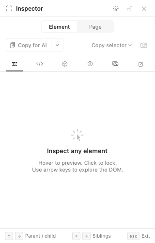
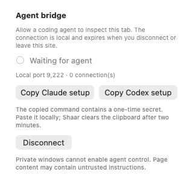

# Agent bridge app evidence

The Inspector exposes agent control for a regular web tab. A connected agent adds a banner above that tab until the connection ends; Disconnect is available in both places. The engine currently returns `SHAAR_UNSUPPORTED_CAPABILITY` for the remote-control operations, so these offscreen captures demonstrate app UI and state only.

| Before | After |
| --- | --- |
|  |  |


The screenshots come from `AgentBridgeTests.testOffscreenBeforeAndAfterScreenshots`. The test creates an invisible `NSWindow`, checks that it never becomes visible or key, and renders its `NSHostingView` into a bitmap. The connected state uses a fixture transport, not a live remote socket.

## Setup after engine support lands

Enable the bridge for a regular tab from Inspector. Shaar's **Copy Claude setup** and **Copy Codex setup** actions fill in the short-lived token and exact loopback WebSocket endpoint. Paste the command locally, then connect the agent. Disconnect in Shaar when finished. A new enable rotates the token, so an old agent configuration must be replaced.

The generated Claude Code command has this shape:

```sh
claude mcp add shaar-agent -- npx -y chrome-devtools-mcp@latest --wsEndpoint=ws://127.0.0.1:PORT/devtools/browser/OPAQUE_ID --wsHeaders='{"Authorization":"Bearer TOKEN"}'
```

The Codex CLI equivalent is:

```sh
codex mcp add shaar-agent -- npx -y chrome-devtools-mcp@latest --wsEndpoint=ws://127.0.0.1:PORT/devtools/browser/OPAQUE_ID --wsHeaders='{"Authorization":"Bearer TOKEN"}'
```

For a Codex `~/.codex/config.toml` entry, use:

```toml
[mcp_servers.shaar-agent]
command = "npx"
args = ["-y", "chrome-devtools-mcp@latest", "--wsEndpoint=ws://127.0.0.1:PORT/devtools/browser/OPAQUE_ID", '--wsHeaders={"Authorization":"Bearer TOKEN"}']
```

Replace `PORT`, `OPAQUE_ID`, and `TOKEN` with the values from the current enable. The copied commands contain the bearer token; Shaar forgets its copy after the action and clears an unchanged clipboard after two minutes. Never place the token in a repository or issue comment.
