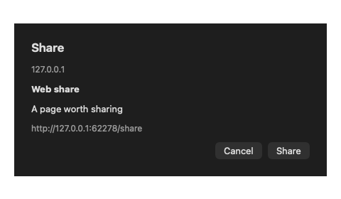

# Web Share sheet

Hidden run of `scripts/test-web-share.py` against
`build/Shaar Verification.app` (shaar.28). The loopback page changed its
title to a prompt marker and no sheet appeared. A share request bound to
that tab, origin, and frame presented this sheet. Sharing recorded
`shared`. Cancelling on the hidden window recorded `cancelled` and did not
open the system share picker. Every window stayed hidden. No new crash
report was written.

The current engine does not send this request. The reply symbol is
optional until patch 0072, so `navigator.share` still does not return on
shaar.28. File menu Share Page is a separate path.

