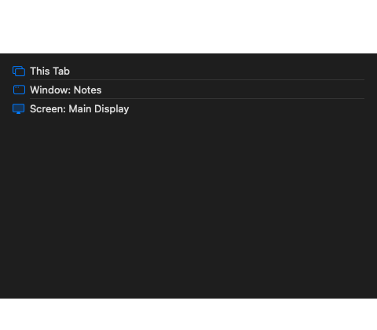

# Screen sharing picker

Hidden run of `scripts/test-platform-prompts.py` against
`build/Shaar Verification.app` (shaar.28). A trusted click on the loopback
page called `getDisplayMedia`. Shaar presented the screen-sharing picker
and every window stayed hidden. Cancelling rejected the call with
`NotAllowedError`. No new crash report was written.

The loading frame is the picker before sources arrive. The second frame
lists this tab, a window, and a screen. Choosing a source on this engine
still needs the capture hook before a MediaStream is produced.

