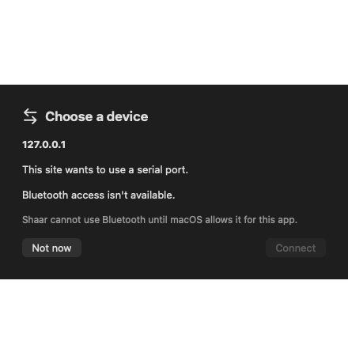
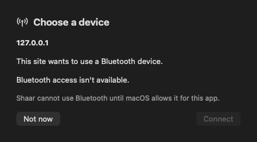
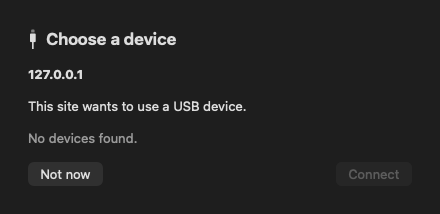
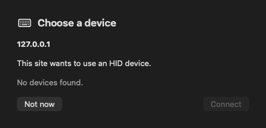
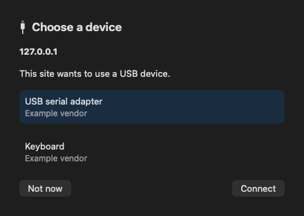

# Device chooser evidence

These are offscreen renders of the SwiftUI device chooser, including its empty and populated states. The hidden verification run uses a trusted click, invokes the real Web APIs, and receives each settled result through the native DevTools completion callback. It does not read a page-owned result variable. On the pinned engine, the chooser event is not sent yet, so these captures use the SwiftUI view directly. Serial, Bluetooth, and USB returned `NotFoundError`; HID resolved with an empty list. The main thread recorded no stall, the Bluetooth run reached `IOBluetoothDeviceInquiry`, all windows stayed hidden, and the run produced no new crash report. Connect stays off until the chooser event includes a device.

