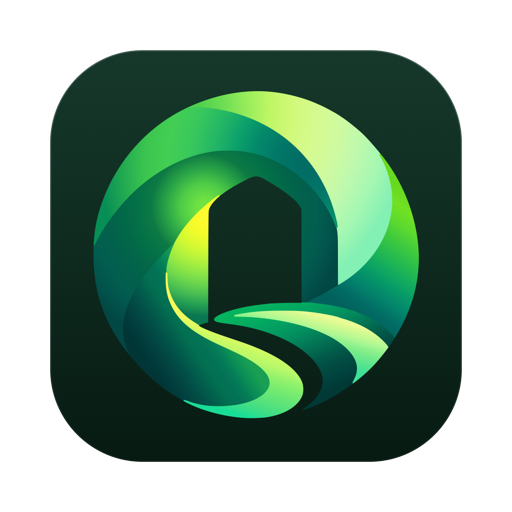
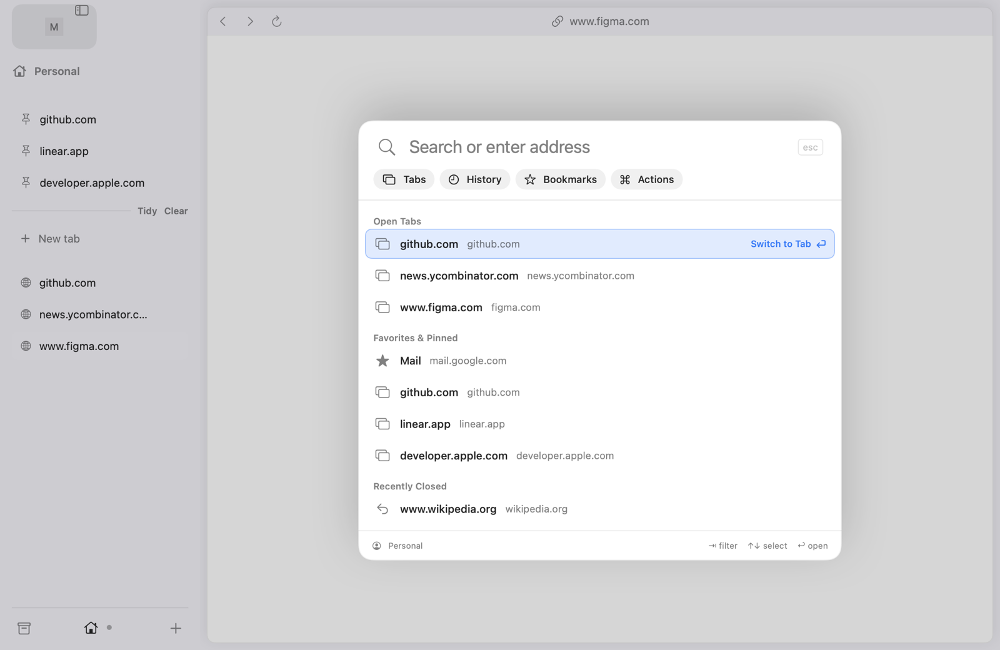
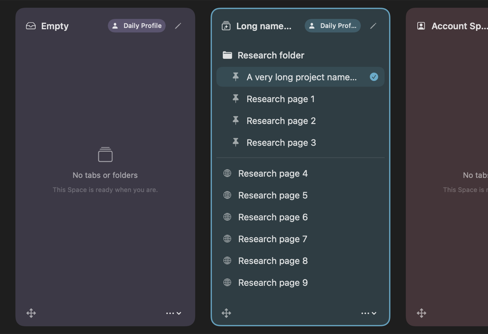
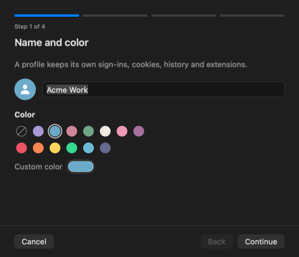
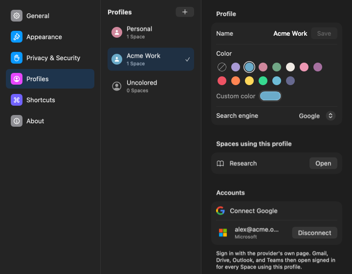
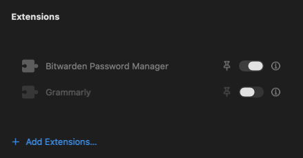

<div align="center">



# Shaar

**A native macOS browser built on Chromium, with Spaces, profiles and a keyboard-first launcher.**

<sub>Shaar (Hebrew שער) means “gateway”.</sub>

<br>

[](https://github.com/arcusis/shaar/actions/workflows/source-checks.yml)
[](https://github.com/arcusis/shaar/releases)
[](#status)
[](LICENSE)
<br>
[](#requirements)
[](#requirements)
[](https://www.swift.org)
[](ThirdParty/ArdiaCore)
[](https://github.com/arcusis/shaar/issues)

[**Download**](https://github.com/arcusis/shaar/releases) ·
[Features](#features) ·
[Build from source](#build-from-source) ·
[Architecture](#architecture) ·
[Contributing](#contributing)

<br>



</div>

## Status

> [!NOTE]
> Shaar is in **early public beta**. It is usable day to day, but expect rough edges and missing features. Please report problems and ideas in [GitHub Issues](https://github.com/arcusis/shaar/issues).

## Features

### Spaces and profiles

Organize browsing into **Spaces**, each with its own tabs, pinned tabs, folders and theme color. Spaces belong to **profiles**, and every profile keeps its own cookies, sign-ins, history and extensions, so work and personal browsing never mix. Library → Spaces shows every Space at a glance in its own color.

<p align="center">
  
</p>

### Profile onboarding with your accounts

A new profile takes four short steps: name and color, then connect **Google** and **Microsoft**, including Google Workspace and Microsoft work or school accounts that sign in through Okta, Azure AD, ADFS or Ping. Gmail, Drive, Outlook and Teams then open signed in for every Space that uses the profile.

<p align="center">
  
  &nbsp;
  
</p>

### Command-T launcher

One keyboard shortcut to search open tabs, favorites, history, bookmarks and browser actions. Filter chips narrow results to one kind, the selected row shows what Enter will do, and the panel opens and closes with smooth motion that respects Reduce Motion.

### Clean links

**Command-Shift-C** copies the current page's link without tracking parameters: `utm_*`, `fbclid`, `gclid`, Instagram `igsh`, X share codes, Amazon referral segments and more. Parameters a page needs, such as a YouTube timestamp, stay.

### Extensions

Install extensions from the Chrome Web Store and manage them per profile, from the toolbar or from Settings → Profiles. Shaar asks before installing and shows exactly which sites an extension can access.

<p align="center">
  
</p>

### And more

- **Search engines per profile:** Google, DuckDuckGo, Brave Search, Kagi, Startpage, Ecosia, Bing or Perplexity.
- **Library:** downloads and media in a Library drawer, recently closed tabs and find in page.
- **Private windows** that leave nothing behind.
- **Automatic updates** through [Sparkle](https://sparkle-project.org), signed with EdDSA and served from this repository's releases.
- **Website permissions** that follow macOS privacy settings for the camera, microphone and location.

## Requirements

- macOS 26 or later
- A Mac with Apple silicon

## Install

Download the latest `Shaar_<version>_aarch64.dmg` from [Releases](https://github.com/arcusis/shaar/releases), open it and drag Shaar to Applications. Releases are signed with Developer ID and notarized by Apple. Shaar checks for updates automatically; you can also choose **Shaar → Check for Updates…**.

## Build from source

You need Xcode 26 with Swift 6.2, plus `bash`, `curl`, `jq`, `rg` and Python 3.

```sh
git clone https://github.com/arcusis/shaar.git
cd shaar

# Build the full app with the pinned Chromium engine
bash scripts/bundle-app.sh --with-engine
open build/Shaar.app
```

The bundle script downloads the pinned engine, verifies its digest and payload, and signs the result ad hoc for local use. For a quick UI-only shell without the engine:

```sh
swift build
swift run ArcusisBrowser
```

More detail, including building the engine from source, is in [Build and Run](Notebook/Build_And_Run.md).

## Architecture

```text
┌──────────────────────────────────────────────────────────────┐
│ Shaar (executable)                                           │
│  └─ ArcusisBrowser  SwiftUI + AppKit app: windows, sidebar,  │
│                     Spaces, settings, launcher, consent UI   │
│      ├─ BrowserCore      sessions, profiles, search, links,  │
│      │                   update feed — pure Swift, no UI     │
│      └─ ChromiumBridge   Objective-C++ bridge to the engine  │
│              └─ Chromium Framework (pinned ArdiaCore build)  │
└──────────────────────────────────────────────────────────────┘
ShaarVerification — separate harness that drives the real engine in tests; never shipped
```

| Module | Role |
|---|---|
| `Sources/ArcusisBrowser` | The app: windows, sidebar, Spaces, Library, settings, Command-T, extension and permission consent. |
| `Sources/BrowserCore` | Platform-independent model: sessions, profiles, workspaces, search, clean links, update feed. |
| `Sources/ChromiumBridge` | Objective-C++ bridge between Swift and the Chromium framework. |
| `Sources/Shaar` | The thin executable that starts the app. |
| `Sources/ShaarVerification` | Verification harness for engine probes; built separately and never distributed. |

Design notes live in the [Notebook](Notebook/_INDEX_Main.md), starting with [Browser Architecture](Notebook/Browser_Architecture.md) and the [Engine Interop Boundary](Notebook/Engine_Interop_Boundary.md).

## Testing

```sh
swift test                                                  # unit and integration tests
swift format lint --strict --recursive Package.swift Sources Tests
.venv/bin/python scripts/test-python.py                     # script and release tooling tests
bash scripts/test-engine.sh                                 # real-engine probes (initial and restart)
```

Every pull request runs the same checks on GitHub-hosted macOS runners, including the engine probes against the pinned Chromium build, a release bundle build and visual captures. See [Test Coverage](Notebook/Test_Coverage.md) and the [Verification Harness](Notebook/Verification_Harness.md).

## Project layout

| Path | Contents |
|---|---|
| `Sources/` | App, core model, Chromium bridge, executable and verification harness |
| `Tests/` | Swift unit, integration and visual tests; Python tests for scripts |
| `Resources/` | App resources, icons and the bundled extension manager |
| `Branding/` | Logo, app icon and the [brand guide](Branding/DESIGN.md) |
| `ThirdParty/` | Pinned upstream inputs with their licenses and notices |
| `scripts/` | Build, bundle, release and verification tools |
| `Notebook/` | Architecture, design and verification notes |

## Roadmap

Planned work is tracked in [GitHub Issues](https://github.com/arcusis/shaar/issues). Highlights:

- Install an extension once for every profile
- Split View with two tabs in one page card
- Passkeys from iCloud Keychain in release builds
- Per-profile download folders and site-data controls
- Content blocking, tab suspension and importing from other browsers

## Contributing

Contributions are welcome. Read [CONTRIBUTING.md](CONTRIBUTING.md) for the build, test and commit conventions, and the [Code of Conduct](CODE_OF_CONDUCT.md). Good places to start are issues labeled [`good first issue`](https://github.com/arcusis/shaar/labels/good%20first%20issue) and [`help wanted`](https://github.com/arcusis/shaar/labels/help%20wanted).

## Security

Please report vulnerabilities privately through [GitHub Security Advisories](https://github.com/arcusis/shaar/security/advisories/new), not public issues. See [SECURITY.md](SECURITY.md).

## Credits

Shaar's design is inspired by [Arc](https://arc.net) by The Browser Company; Shaar is independent and not affiliated with them. It is built on [Chromium](https://www.chromium.org) through [ArdiaCore](https://github.com/mantrakp04/ardia) and uses [Sparkle](https://sparkle-project.org) for updates. See [CREDITS.md](CREDITS.md) for full acknowledgements, and [NOTICE](NOTICE) and [THIRD_PARTY_NOTICES.md](THIRD_PARTY_NOTICES.md) for third-party licenses.

## License

Shaar is licensed under the [Mozilla Public License 2.0](LICENSE).
Copyright © 2026 Arcusis LTD.

<div align="center">
<br>

</div>
